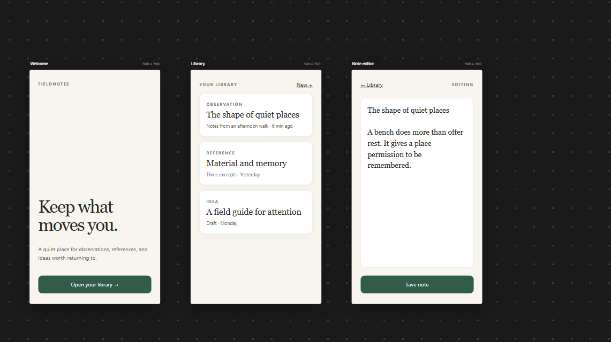

# Prototype Board

A local canvas for reviewing HTML prototypes side by side. Pan, zoom, and open any artboard for an interactive preview. Add notes and text overrides while keeping the source HTML intact.



[⬇️ Install](#-install) · [🎨 Use the board](#-use-the-board) · [🏷️ Releases](https://github.com/netizenaki/prototype-board/releases)

## 📦 Install

Requires **Node.js 20+**. Expand the instructions for your agent.

<details>
<summary><strong>Codex · Custom marketplace</strong></summary>

Add the marketplace, then install the plugin:

```sh
codex plugin marketplace add netizenaki/prototype-board
codex plugin add prototype-board@prototype-board-tools
```

After adding the marketplace, you can also install from **Plugins → Prototype Board Tools → Prototype Board** in the ChatGPT desktop app.

**Update:** Run `codex plugin marketplace upgrade prototype-board-tools`. If you installed from a Git clone, run `git pull --ff-only` in that clone.

</details>

<details>
<summary><strong>Kimi Code · Custom marketplace</strong></summary>

1. Open the custom marketplace:

   ```text
   /plugins marketplace https://raw.githubusercontent.com/netizenaki/prototype-board/main/kimi.marketplace.json
   ```

2. Select **Prototype Board** and press **Enter** to install it.
3. Run `/reload` to load the plugin in your session.

For a direct install or update, run:

```text
/plugins install https://github.com/netizenaki/prototype-board
/reload
```

Open or reopen a board from its project with `/prototype-board:open`.

</details>

<details>
<summary><strong>Gemini CLI · Extension</strong></summary>

Install from your terminal:

```sh
gemini extensions install https://github.com/netizenaki/prototype-board
```

Start a new Gemini CLI session to load the extension.

**Update:** Run `gemini extensions update prototype-board`, then start a new session.

</details>

<details>
<summary><strong>OpenCode and other Agent Skills hosts · Local skill</strong></summary>

1. Copy the entire [`skills/prototype-board`](skills/prototype-board) folder into your agent's skills directory. For OpenCode, use `~/.config/opencode/skills/` for all projects or `.opencode/skills/` for one project.
2. Open your project in the agent and ask it to open Prototype Board.

**Update:** Replace the installed skill folder with the copy from the latest [release](https://github.com/netizenaki/prototype-board/releases/latest).

</details>

## 🎨 Use the board

1. From your project, ask your agent to **“Open my Prototype Board.”**
2. Add trusted HTML prototypes to the project's `.prototype-board/` folder and ask the agent to reopen the board.
3. Click an artboard to preview it. Use **Edit** to move or rename boards, add notes, or save text overrides. Use **Pause animations** to stop the live preview.

After updating the skill, reopen the board from its project to rebuild the viewer. Saved edits and source HTML are preserved.

<details>
<summary><strong>Shortcuts and layout</strong></summary>

| Action | Shortcut |
| --- | --- |
| Pan | Drag empty canvas or scroll |
| Zoom | Ctrl + scroll |
| Fit all boards | F |
| Search | Ctrl / Cmd + K |
| Switch or close previews | ← / → or Esc |

Boards are arranged in a grid by default. For custom page names, artboard dimensions, and positions, see [`example/canvas.json`](example/canvas.json).

</details>

<details>
<summary><strong>Run without an agent</strong></summary>

From the project you want to open, run both commands. Replace `/path/to/prototype-board-skill` with the path to the installed skill folder. In this repository, the skill folder is `skills/prototype-board`.

```sh
node "/path/to/prototype-board-skill/scripts/build.mjs"
node "/path/to/prototype-board-skill/scripts/serve.mjs"
```

Open the printed HTTP URL for editing. For read-only viewing, open `.prototype-board/index.html` directly.

</details>

[MIT License](LICENSE)
